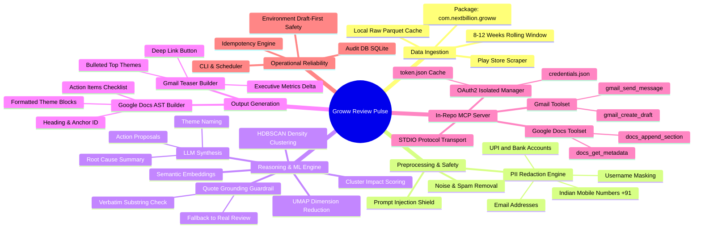
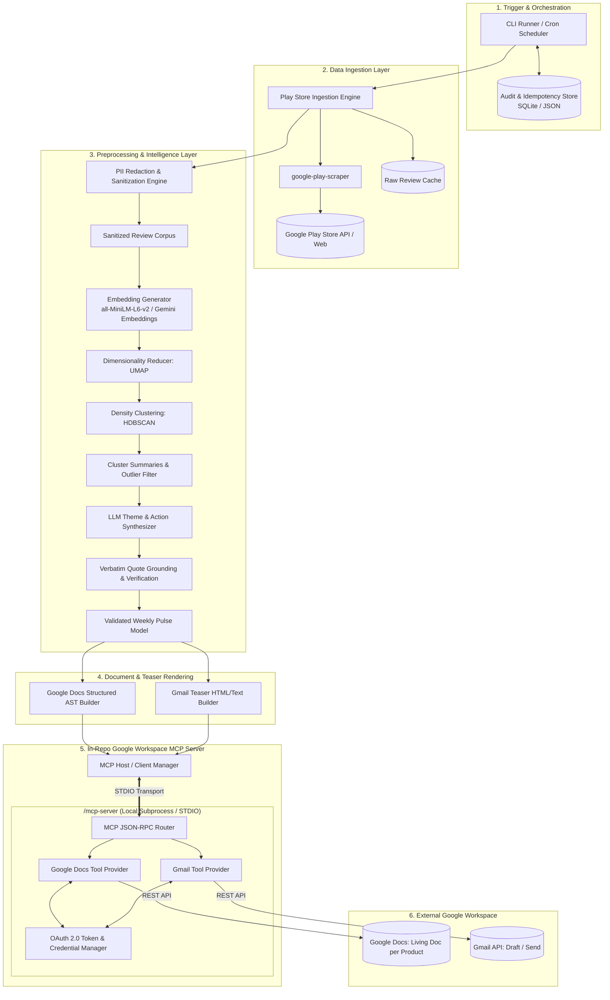
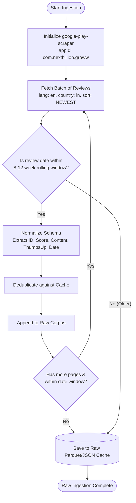
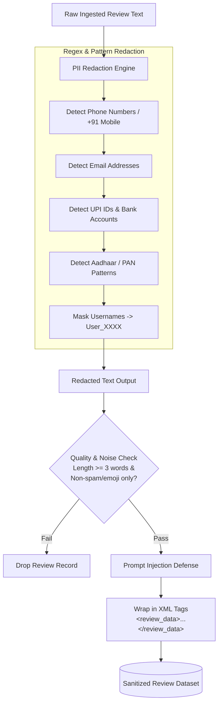
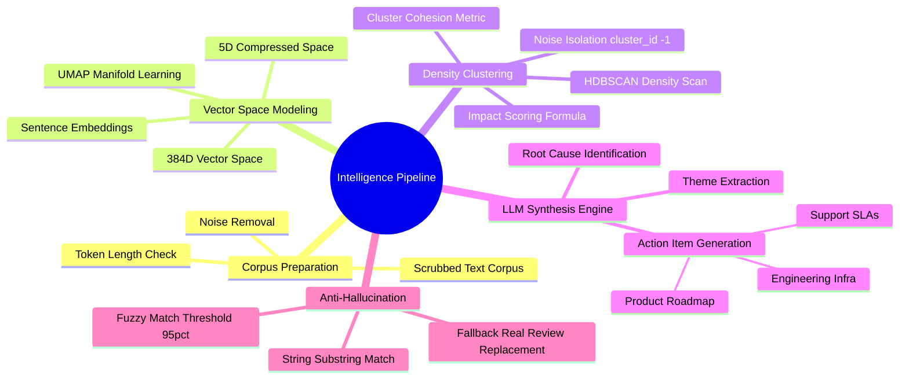
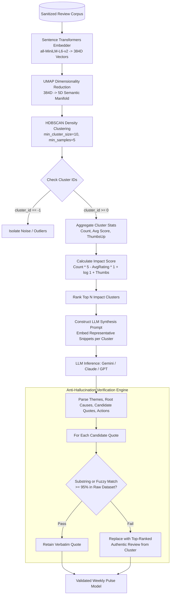
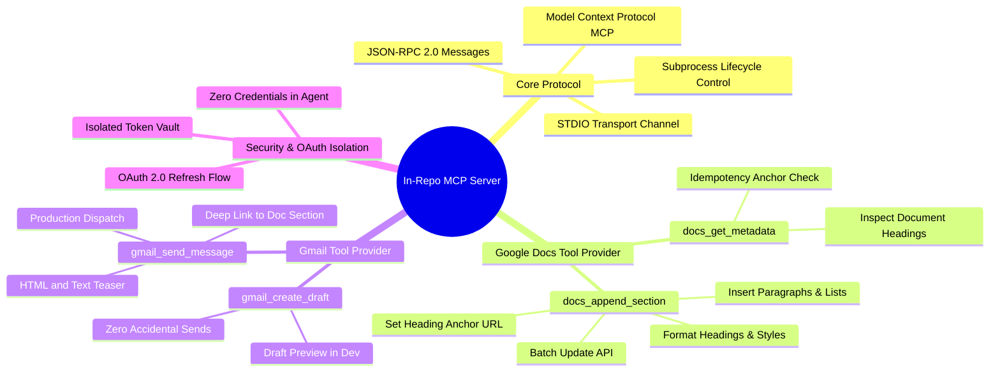
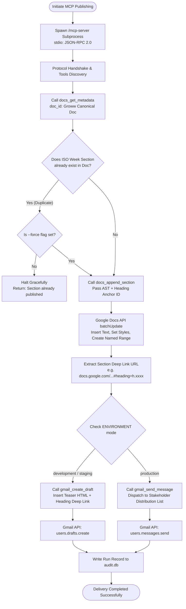
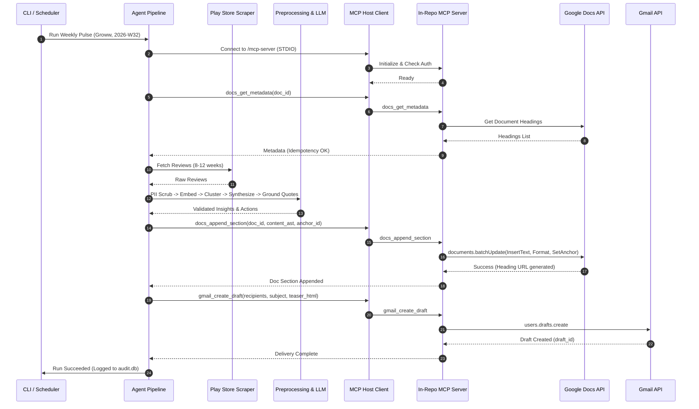

# Weekly Product Review Pulse — System Architecture

## 1. Architecture Overview

The **Weekly Product Review Pulse** is architected as an end-to-end, decoupled intelligence pipeline and MCP-driven delivery system. It transforms high-volume, unstructured mobile app store reviews into structured, actionable weekly reports for product, support, and leadership teams.

The system adheres to **Clean Architecture** principles, strictly segregating:
1. **Data Ingestion** (Play Store scraping & caching)
2. **Preprocessing & Safety** (PII scrubbing & data sanitization)
3. **Clustering & Reasoning** (Embeddings, UMAP + HDBSCAN, LLM synthesis with grounded quote verification)
4. **Report Rendering** (Structured Google Docs AST & Gmail HTML/plain-text teasers)
5. **In-Repository Google Workspace MCP Server** (Isolated MCP server exposing Google Docs and Gmail tools over standard STDIO transport)
6. **Agent Orchestrator & CLI** (Execution lifecycle, idempotency management, and audit logging)

---

## 2. System Architecture & Flow Mind Maps

### 2.1. Macro Architecture Mind Map

The following mind map illustrates the comprehensive operational flow and structural composition of the system:



---

## 3. End-to-End System Pipeline Diagram



---

## 4. Component Flow Diagrams & Design Specifications

### 4.1. Ingestion Layer (`src/ingestion`)

#### Ingestion & Filtering Flow Diagram:



- **Target Application**: Groww (`com.nextbillion.groww`).
- **Scraper Mechanism**: Uses `google-play-scraper` with parameterization for:
  - Language: `en` / Country: `in`
  - Sorting: `Sort.NEWEST`
  - Filter: Date-based filtering for rolling 8–12 weeks (configurable via `config/settings.yaml`).
- **Review Normalization**: Ingested records are normalized into a strongly-typed schema:
  ```json
  {
    "review_id": "gp:AOqpTO...",
    "user_name": "Anonymous / Scrubbed",
    "score": 1,
    "content": "App crashes during market opening...",
    "thumbs_up_count": 14,
    "review_created_version": "14.2.1",
    "at": "2026-08-01T09:15:30Z",
    "reply_content": null,
    "replied_at": null
  }
  ```
- **Caching**: Local parquet/json storage to prevent redundant network fetches across retries.

---

### 4.2. Preprocessing & PII Scrubbing (`src/preprocessing`)

#### PII Scrubbing & Data Sanitization Flow Diagram:



- **Data Scrubbing**:
  - Regular expressions & NER detectors strip email addresses, phone numbers, Indian mobile formats (+91/0), Aadhaar/PAN formats, UPI IDs (`user@okhdfcbank`), and specific account numbers.
  - Usernames are anonymized or masked (`User_A19B`).
- **Data Sanitization & Injection Defense**:
  - Reviews are wrapped strictly in `<review_data>` tags when fed to the LLM.
  - Strips prompt-injection triggers (e.g., `"Ignore previous instructions"`, system prompt overrides).
- **Filtering**:
  - Discards uninformative reviews (single emojis, `< 3` words with neutral sentiment, spam bot repetitions).

---

### 4.3. Intelligence, Clustering & Reasoning Layer (`src/reasoning`)

#### Intelligence Subsystem Mind Map:



#### Clustering & LLM Grounding Flow Diagram:



#### A. Embedding & Dimensionality Reduction
- **Embedding Generation**: Generates high-density semantic vector representations for all review texts using a lightweight, performant embedding model (e.g., `sentence-transformers/all-MiniLM-L6-v2` or Google `text-embedding-004`).
- **UMAP Reduction**: Reduces dimensions (from 384/768 down to 5–10 components) to preserve local and global semantic manifold structure (`metric='cosine'`, `n_neighbors=15`, `min_dist=0.1`).

#### B. Density-Based Clustering (HDBSCAN)
- **HDBSCAN Clustering**: Clusters reviews by semantic density (`min_cluster_size=10`, `min_samples=5`).
- Isolates noise/outliers into a separate bucket (`cluster_id = -1`) ensuring only cohesive feedback clusters drive the weekly themes.
- Ranks clusters by impact score:
  $$\text{Impact Score} = \text{Count} \times (5 - \text{Avg Rating}) \times (1 + \log(1 + \text{Total ThumbsUp}))$$

#### C. LLM Theme Synthesis & Verbatim Quote Verification
- **LLM Prompting**: Evaluates top clusters to extract:
  1. **Theme Name & Core Issue**: Crisp 1-line label + 1-sentence explanation.
  2. **Representative Verbatim Quotes**: 2–3 quotes reflecting customer sentiment.
  3. **Targeted Action Ideas**: Concrete steps for Product, Support, and Engineering/Infra.
- **Strict Quote Grounding Guardrail**:
  - Every candidate quote returned by the LLM undergoes algorithmic string/fuzzy verification against the sanitized raw review dataset.
  - If a quote cannot be found in the actual review corpus with $>95\%$ string match, it is rejected and replaced with the highest-ranked authentic review from that cluster.

---

### 4.4. Output Rendering Layer (`src/renderer`)

Generates two complementary delivery artifacts:

1. **Google Docs Section AST (`DocSectionAST`)**:
   - Formatted for Google Docs batch updates:
     - Heading 1: `Week {YYYY-Www} — ({StartDate} to {EndDate})`
     - Heading 2: `Executive Summary & Top Themes`
     - Bulleted theme summaries with severity indicators.
     - Blockquote styled callout boxes for verbatim quotes.
     - Action ideas formatted in structured tables or checklists.
   - Embeds a deterministic named anchor ID (`#heading=h.groww_{iso_week}`).

2. **Gmail Teaser HTML/Plaintext (`EmailPayload`)**:
   - Short executive preview (3–5 bullet points).
   - High-level metric delta (e.g., Total Reviews, Avg Rating, % Negative).
   - Call-to-action button/link: **"Read Full Pulse in Google Docs"** pointing directly to the generated anchor heading in the canonical Doc.

---

### 4.5. In-Repository Google Workspace MCP Server (`/mcp-server`)

The MCP Server is implemented directly within this codebase under `/mcp-server`. It implements the **Model Context Protocol (MCP)** specification over standard STDIO transport.

#### In-Repo MCP Server Mind Map:



#### MCP Delivery & Invocation Flow Diagram:



```
mcp-server/
├── __init__.py
├── server.py              # FastMCP / Standard MCP Server entrypoint
├── config.py              # Server configurations & OAuth scope definitions
├── auth/
│   ├── oauth_handler.py   # Google OAuth 2.0 web / local token flow
│   └── token_storage.py   # Secure local token.json caching
├── tools/
│   ├── docs_tools.py      # Google Docs append, formatting & anchor insertion
│   └── gmail_tools.py     # Gmail draft creation & email dispatch
└── services/
    ├── google_docs.py     # Google Docs API client wrappers (batchUpdate)
    └── google_gmail.py    # Gmail API client wrappers
```

#### Exposed MCP Tools:

| Tool Name | Parameters | Return Type | Description |
| :--- | :--- | :--- | :--- |
| `docs_get_metadata` | `doc_id: str` | `DocMetadata` | Inspects existing headings and sections to verify idempotency before writing. |
| `docs_append_section` | `doc_id: str, heading: str, anchor_id: str, blocks: List[DocBlock]` | `AppendResult` | Appends a structured, formatted weekly section at the end of the Google Doc. |
| `create_email_draft` | `recipient: str, subject: str, body_html: str, body_text: str` | `DraftResult` | Creates a draft teaser email in Gmail (default in dev/staging). |
| `send_email` | `recipient: str, subject: str, body_html: str, body_text: str, idempotency_key: str` | `SendResult` | Sends the teaser email to the stakeholder distribution list with deep link. |

---

### 4.6. Orchestrator, CLI & Idempotency Manager (`src/agent`)

#### Complete Lifecycle & Idempotency Decision Flow:

```mermaid
flowchart TD
    CLIStart([CLI Invoked: python -m src.agent.cli]) --> ParseArgs[Parse CLI Arguments<br/>--product groww, --week, --force, --draft-only]
    ParseArgs --> QueryAuditDB[(Query local audit.db)]
    QueryAuditDB --> CheckDB{Is (Product, Week)<br/>already recorded in DB?}
    
    CheckDB -- Yes & not force --> ExitAudit[Exit: Run already completed for this week]
    CheckDB -- No or force --> IngestStep[Execute Ingestion Pipeline]
    
    IngestStep --> PreprocessStep[Execute PII Scrubbing & Sanitization]
    PreprocessStep --> ReasonStep[Execute Embeddings, Clustering & LLM Synthesis]
    ReasonStep --> GroundStep[Execute Verbatim Quote Verification]
    GroundStep --> RenderStep[Generate Docs AST & Gmail Teaser Payload]
    
    RenderStep --> MCPAgent[Invoke In-Repo MCP Server]
    MCPAgent --> AppendDocs[Execute docs_append_section]
    AppendDocs --> DeliverMail{Check --draft-only or Dev Env}
    
    DeliverMail -- True --> CreateDraft[Execute gmail_create_draft]
    DeliverMail -- False --> SendMessage[Execute gmail_send_message]
    
    CreateDraft --> RecordDB[(Write Record to audit.db<br/>timestamp, counts, heading_id, msg_id)]
    SendMessage --> RecordDB
    RecordDB --> EndSuccess([Pipeline Succeeded])
```

- **Execution Flow**:
  1. CLI invoked: `python -m src.agent.cli --product groww --week 2026-W32 [--draft-only]`
  2. Idempotency Check: Checks local SQLite database (`audit.db`) and queries `docs_get_metadata` via MCP. If section `2026-W32` exists and `--force` is not specified, halts gracefully.
  3. Scrapes, preprocesses, embeds, clusters, and synthesizes review data.
  4. Spawns local MCP Server subprocess over STDIO.
  5. Calls `docs_append_section` with generated AST.
  6. Calls `gmail_create_draft` (or `gmail_send_message` in production mode).
  7. Records run audit metadata (run timestamp, review count, cluster metrics, doc heading ID, email message ID).

---

## 5. End-to-End Sequence Diagram



---

## 6. Repository Directory Layout

```
Product Review Analysis Agent/
├── docs/
│   ├── problemStatement.md     # Problem statement & context specification
│   ├── architecture.md         # Detailed architectural blueprint (this file)
│   └── setup_guide.md          # Google Cloud OAuth & MCP environment setup
├── mcp-server/                 # In-Repo Google Workspace MCP Server
│   ├── auth/
│   │   ├── __init__.py
│   │   ├── oauth.py            # OAuth 2.0 flow handler
│   │   └── scopes.py           # Google Docs & Gmail permission scopes
│   ├── tools/
│   │   ├── __init__.py
│   │   ├── docs_tools.py       # Docs append & formatting MCP tools
│   │   └── gmail_tools.py      # Gmail draft/send MCP tools
│   ├── services/
│   │   ├── __init__.py
│   │   ├── docs_service.py     # Google Docs REST client wrapper
│   │   └── gmail_service.py    # Gmail REST client wrapper
│   ├── server.py               # FastMCP server runner
│   └── pyproject.toml          # MCP server dependencies
├── src/                        # Core Agent & Intelligence Pipeline
│   ├── ingestion/
│   │   ├── __init__.py
│   │   ├── play_store.py       # Google Play scraper & normalizer
│   │   └── cache.py            # Review disk caching
│   ├── preprocessing/
│   │   ├── __init__.py
│   │   ├── pii_scrubber.py     # Regex + rule-based PII redaction
│   │   └── sanitization.py     # Prompt injection filter & cleaning
│   ├── reasoning/
│   │   ├── __init__.py
│   │   ├── embedder.py         # Embedding generation
│   │   ├── clusterer.py        # UMAP + HDBSCAN pipeline
│   │   ├── synthesizer.py      # LLM theme naming & action synthesis
│   │   └── quote_grounder.py   # Verbatim quote string verification
│   ├── renderer/
│   │   ├── __init__.py
│   │   ├── doc_renderer.py     # Google Docs AST builder
│   │   └── email_renderer.py   # Teaser email HTML/plain-text builder
│   ├── agent/
│   │   ├── __init__.py
│   │   ├── orchestrator.py     # Pipeline coordinator
│   │   ├── mcp_client.py       # MCP client interface (connects to https://web-production-c16ea.up.railway.app)
│   │   ├── idempotency.py      # Run audit store & idempotency guard
│   │   └── cli.py              # CLI entry point
│   └── models/
│       ├── __init__.py
│       ├── review.py           # Pydantic schemas for review objects
│       ├── cluster.py          # Cluster & insight models
│       └── report.py           # Pulse report & action items models
├── config/
│   ├── settings.yaml           # Pipeline configs (rolling window, cluster params, MCP URL)
│   └── products.yaml           # Product configs (Groww package ID, Doc ID, emails)
├── tests/
│   ├── test_ingestion.py
│   ├── test_pii_scrubber.py
│   ├── test_clustering.py
│   ├── test_quote_grounder.py
│   ├── test_doc_renderer.py
│   ├── test_email_renderer.py
│   ├── test_config.py
│   ├── test_models.py
│   └── test_mcp_client.py
├── .env.example                # Environment variables template
├── requirements.txt            # Project dependencies
└── README.md                   # Project overview & quickstart
```

---

## 7. Security, Privacy & Reliability Guardrails

1. **OAuth Credential Isolation**:
   - OAuth `credentials.json` and generated `token.json` are isolated strictly within the MCP Server runtime.
   - Core agent logic and review processing modules have zero access to Google API keys or refresh tokens.
2. **Prompt Injection & Untrusted Data Containment**:
   - Review content is sanitized and wrapped within explicit XML demarcations `<customer_reviews>` with instructions to the LLM to treat content purely as passive analytical data.
3. **Anti-Hallucination Quote Guardrail**:
   - Every quote published in the report must strictly pass substring matching against the ingested review dataset.
4. **Environment Run Safety**:
   - `ENVIRONMENT=development` defaults to `gmail_create_draft` mode, preventing accidental email blasts during local development or staging tests.
5. **Idempotency Guarantee**:
   - Checks both local audit history and canonical Doc headings prior to execution, ensuring re-runs do not create duplicate sections or send repeated stakeholder emails.
