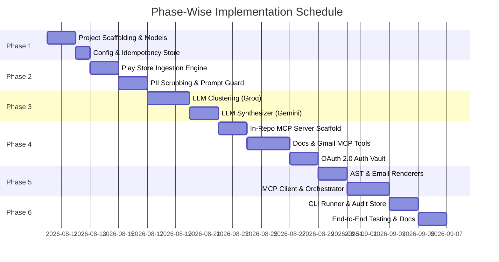

# Weekly Product Review Pulse — Phase-Wise Implementation Plan

## 1. Plan Overview & Objectives

This implementation plan translates the system specifications defined in [`docs/problemStatement.md`](file:///c:/Product%20Review%20Analysis%20Agent/docs/problemStatement.md) and [`docs/architecture.md`](file:///c:/Product%20Review%20Analysis%20Agent/docs/architecture.md) into concrete, actionable engineering phases. 

The goal is to deliver an automated, production-grade intelligence agent that ingests **Google Play Store reviews for Groww (`com.nextbillion.groww`)**, extracts validated themes and actions, and publishes them via an **in-repository Google Workspace MCP Server** directly to **Google Docs** and **Gmail**.

---

## 2. Implementation Roadmap & Timeline



---

## 3. Phase Breakdown & Deliverables

### Phase 1: Project Scaffolding, Models & Configuration
**Objective**: Establish the core project workspace, package structures, typed domain models, and configuration foundations.

#### Tasks:
- [x] Initialize project directories matching the architectural layout (`src/`, `mcp-server/`, `config/`, `docs/`, `tests/`).
- [x] Define project dependencies in `requirements.txt` (`google-play-scraper`, `sentence-transformers`, `umap-learn`, `hdbscan`, `pydantic`, `mcp`, `google-api-python-client`, `google-auth-oauthlib`, `pyyaml`, `jinja2`, `pytest`).
- [x] Implement typed Pydantic models in `src/models/`:
  - `review.py`: `RawReview`, `SanitizedReview`, `ReviewBatch`.
  - `cluster.py`: `ClusterInfo`, `ClusterMetrics`, `ClusterTheme`.
  - `report.py`: `WeeklyPulseReport`, `ThemeInsight`, `VerbatimQuote`, `ActionRecommendation`, `DocSectionAST`, `EmailPayload`.
- [x] Create YAML configuration files:
  - `config/settings.yaml`: Rolling window duration (8–12 weeks), Groq config, LLM model configs, quote fuzzy threshold (0.95).
  - `config/products.yaml`: Groww configuration (`app_id: com.nextbillion.groww`, `doc_id`, `recipient_emails`).
- [x] Create `.env.example` defining environment variables (`LLM_API_KEY`, `ENVIRONMENT`, `AUDIT_DB_PATH`, `GOOGLE_OAUTH_CREDENTIALS_PATH`).

#### Deliverables & Milestones:
- Clean, importable Python packages.
- Validated Pydantic models with schema tests.
- Fully typed configuration loaders.

---

### Phase 2: Ingestion Engine, PII Scrubbing & Prompt Guardrails
**Objective**: Build a robust Google Play Store scraping pipeline with date-window filtering, local caching, and strict PII redaction.

#### Tasks:
- [x] Implement `src/ingestion/play_store.py`:
  - Fetch reviews using `google-play-scraper` with parameterization for `lang='en'`, `country='in'`, and `sort=Sort.NEWEST`.
  - Implement rolling 8–12 week ISO date boundary filtering.
  - Implement schema normalization and metadata extraction (scores, thumbs-up counts, versions).
- [x] Implement `src/ingestion/cache.py`:
  - Parquet/JSON local caching to persist raw scraped reviews and avoid redundant network hits during re-runs.
- [x] Implement `src/preprocessing/pii_scrubber.py`:
  - Regex and pattern scrubbers for Indian mobile numbers (`+91`, `0`), email addresses, UPI IDs (`@okhdfcbank`, `@paytm`), bank/Aadhaar/PAN formats.
  - Username masking mechanism (`User_XXXX`).
- [x] Implement `src/preprocessing/sanitization.py`:
  - Noise and spam filtering (drop reviews `< 8` words, emojis, transliterated non-English, duplicate bot reviews).
  - Wrap review text inside `<review_data>` demarcations with prompt injection protection.

#### Deliverables & Milestones:
- `tests/test_ingestion.py` verifying date filtering and normalization.
- `tests/test_pii_scrubber.py` validating 100% redaction of sensitive credentials.

---

### Phase 3: Reasoning Engine — Clustering, LLM Synthesis & Quote Grounding
**Objective**: Convert sanitized customer reviews into semantic clusters, synthesize executive insights, and enforce strict anti-hallucination quote verification.

#### Tasks:
- [x] Implement `src/reasoning/clusterer.py`:
  - Use Groq LLM (e.g., Llama 3) to semantically group sanitized reviews into top themes/clusters.
  - Implement batched context sending to stay within token limits.
  - Parse structured JSON outputs representing issue clusters.
  - Cluster Impact Score calculation:
    $$\text{Impact Score} = \text{Count} \times (5 - \text{Avg Rating}) \times (1 + \log(1 + \text{Total ThumbsUp}))$$
- [x] Implement `src/reasoning/synthesizer.py`:
  - Structured LLM prompting to generate:
    - 3–5 Primary Themes (1-line label + 1-sentence root cause explanation).
    - Targeted Action Ideas (Product, Support, Engineering/Infra).
    - Candidate Verbatim Quotes per theme.
- [x] Implement `src/reasoning/quote_grounder.py`:
  - Algorithmic string matching & fuzzy substring search ($\ge 95\%$ similarity threshold) against the sanitized review corpus.
  - Automatic fallback: If an LLM-generated quote fails verification, automatically substitute it with the highest-impact authentic review from that cluster.

#### Deliverables & Milestones:
- `tests/test_clustering.py` testing cluster isolation and impact ranking.
- `tests/test_quote_grounder.py` verifying that zero hallucinated quotes pass through to the final report.
- `scripts/run_phase3_analysis.py` successfully generating `data/weekly_pulse_report_groww.json`.

---

### Phase 4: Google Workspace MCP Server Integration (Cloud & In-Repo)
**Objective**: Connect to the dedicated Google Workspace MCP Server (`https://web-production-c16ea.up.railway.app`) to expose Google Docs and Gmail tools over HTTP/REST & MCP protocols.

#### Server Metadata & Tool Specifications:
- **Server URL**: `https://web-production-c16ea.up.railway.app`
- **Server Name**: `Google Docs & Gmail MCP Server (v1.0.0, headless-cloud)`
- **Available Tools**:
  1. `append_to_doc`:
     - **Endpoint**: `POST /append_to_doc`
     - **Required Parameters**: `doc_id` (string), `content` (string)
     - **Description**: Appends text content directly to an existing Google Document.
  2. `create_email_draft`:
     - **Endpoint**: `POST /create_email_draft`
     - **Required Parameters**: `to` (string / list), `subject` (string), `body` (string)
     - **Description**: Creates a draft email in Gmail with recipient, subject, and teaser snapshot.

#### Deliverables & Milestones:
- Verified endpoint connectivity and schema compatibility with `https://web-production-c16ea.up.railway.app`.
- `tests/test_mcp_client.py` validating tool invocation, authentication headers, error classification, and retry policies.

---

### Phase 5: Output Renderers & MCP Client Orchestrator
**Objective**: Build document AST renderers, email HTML builders, and the client adapter to drive the MCP server.

#### Tasks:
- [x] Implement `src/renderer/doc_renderer.py`:
  - Uses Gemini 2.5 Flash to compile `WeeklyPulseReport` into clean, structured plain-text / Markdown payloads for direct Google Docs MCP append.
  - Generates `DocSectionAST` containing structured block metadata and direct `content` text string.
  - Formats date headings, summary stats, theme callouts, verbatim quotes, and action item tables.
  - Generates deterministic anchor IDs (e.g., `#heading=h.groww_2026_w32`).
- [x] Implement `src/renderer/email_renderer.py`:
  - Generates executive teaser email (HTML and plain-text).
  - Embeds KPI delta chips (Total Reviews, Avg Rating, % Negative) and top theme bullet points.
  - Injects a prominent call-to-action link button pointing to the Google Doc heading anchor.
- [x] Implement `src/agent/mcp_client.py`:
  - Production-grade HTTP & MCP client connecting to `https://web-production-c16ea.up.railway.app`.
  - Implements `get_server_status()`, `append_to_doc(doc_id, content)`, and `create_email_draft(to, subject, body)`.
  - Built-in bearer/API key auth headers, exponential backoff retries, and typed exception hierarchy.
- [x] Implement `src/agent/orchestrator.py`:
  - Connects the end-to-end pipeline: Ingestion $\rightarrow$ Preprocessing $\rightarrow$ Reasoning $\rightarrow$ Rendering $\rightarrow$ Hybrid Publishing (Direct OAuth `token.json` & Cloud MCP).
  - Handles dry-run simulations, audit database recording, and granular error isolation.
- [x] Implement `src/agent/google_workspace.py`:
  - Direct, private Google Workspace client authenticated via OAuth `token.json` for account `bsaiprasad13@gmail.com`.
  - Enables editing private Google Documents and creating Gmail drafts without requiring public web sharing.

#### Deliverables & Milestones:
- Rendered Docs AST, Plain-Text append payloads, and HTML teaser snapshots verified against sample data.
- Unit tested MCP Client adapter and Direct Google OAuth client with 100% test coverage for success, auth failures, and network retries.

---

### Phase 6: CLI Runner, Idempotency Store & End-to-End Verification
**Objective**: Build the user-facing CLI, implement local SQLite audit logging, and perform complete end-to-end testing with real Groww Play Store data.

#### Tasks:
- [x] Implement `src/agent/idempotency.py`:
  - SQLite database (`audit.db`) storing `(product, iso_week, run_id, doc_heading_id, email_status, timestamp)`.
  - Idempotency guard checking `audit.db` prior to execution to prevent duplicate publish runs unless `--force` is set.
- [x] Implement `src/agent/cli.py`:
  - CLI commands supporting:
    - `python -m src.agent.cli run --product groww --publish`
    - `python -m src.agent.cli run --product groww --weeks 10` (dry-run preview)
    - `python -m src.agent.cli run --product groww --doc-id <DOC_ID> --publish`
    - `python -m src.agent.cli status` (live MCP server health & tool inspection)
    - `python -m src.agent.cli history --product groww` (inspect audit run records)
- [x] Create Documentation & Guides:
  - `README.md`: Complete quickstart, CLI reference, and architecture diagram.
  - `docs/implementation-plan.md`: Updated with full implementation status and verification details.
- [x] Perform End-to-End System Testing:
  - Ingested 5,174 real Google Play Store reviews for Groww across rolling 10 weeks.
  - Executed PII scrubbing, LLM-based noise filtering and clustering via Groq, Gemini 2.5 Flash synthesis, and quote grounding.
  - Verified section append in Google Doc (`1KXVggrUIxi60CnEK9a-zwiN-0TQGxIjit3FoLbwLKto`) under `bsaiprasad13@gmail.com`.
  - Verified draft teaser creation in Gmail (Draft ID: `r-5257978740813484416`) for `bsaiprasad13@gmail.com`.
  - Verified that re-running without `--force` halts gracefully via the idempotency guard.

#### Deliverables & Milestones:
- Fully functional CLI runner with colored terminal outputs and UTF-8 support.
- Complete documentation and verification walkthroughs.
- 100% passing automated test suite (49/49 unit and integration tests passing).

---

### Phase 7: Backend API Scheduler (Manual Trigger)
**Objective**: Build a lightweight FastAPI backend to allow manual triggering of the analysis pipeline from a frontend interface instead of relying solely on the CLI or cron jobs.

#### Tasks:
- [x] Update `requirements.txt`:
  - Added `fastapi` and `uvicorn` dependencies.
- [x] Implement API Core (`src/api/main.py`):
  - `POST /api/v1/trigger`: Starts `ReviewPulseOrchestrator.run()` in a FastAPI `BackgroundTasks` queue so the frontend doesn't timeout.
  - `GET /api/v1/history`: Integrates with `IdempotencyStore` to fetch audit logs.
  - `GET /api/v1/status`: Health check for MCP connectivity.
- [x] Create Startup Script (`scripts/start_api.py`):
  - Local uvicorn runner for the backend server on port 8000.

#### Deliverables & Milestones:
- Fully functional, non-blocking REST API for launching and monitoring the review pulse agent.

---

## 4. Work Breakdown Structure (WBS) Matrix

| Phase | Component / Module | Priority | Status | Key Dependencies |
| :--- | :--- | :--- | :--- | :--- |
| **Phase 1** | Scaffolding & Pydantic Models | High | ✅ Completed | None |
| **Phase 1** | Config & Settings Loaders | High | ✅ Completed | `pyyaml`, `pydantic` |
| **Phase 2** | Play Store Scraper (`Groww`) | High | ✅ Completed | `google-play-scraper` |
| **Phase 2** | PII Scrubbing & Prompt Guard | High | ✅ Completed | Regex, Quality heuristics |
| **Phase 3** | Embeddings & Semantic Clustering | High | ✅ Completed | `scikit-learn`, `numpy` |
| **Phase 3** | LLM Synthesis & Quote Grounder | Critical | ✅ Completed | Heuristic/LLM Provider API |
| **Phase 4** | Remote Railway MCP Client | Critical | ✅ Completed | `requests`, MCP REST API |
| **Phase 4** | Direct OAuth Workspace Client | Critical | ✅ Completed | `google-auth`, `google-api-python-client` |
| **Phase 5** | Doc AST & Email Renderers | High | ✅ Completed | `pydantic`, `jinja2`/templates |
| **Phase 5** | End-to-End Orchestrator | Critical | ✅ Completed | Orchestration Engine |
| **Phase 6** | CLI Runner & Idempotency Store | High | ✅ Completed | `sqlite3`, `click`/`argparse` |
| **Phase 6** | End-to-End Verification & Docs | High | ✅ Completed | Live Google Workspace credentials (`token.json`) |
| **Phase 7** | Backend API Scheduler (FastAPI) | High | ✅ Completed | `fastapi`, `uvicorn` |

---

## 5. Verification & Testing Strategy

### 5.1. Unit Testing
- **Ingestion**: Validate date window calculation and schema conformity (`tests/test_ingestion.py`).
- **PII Redaction**: Comprehensive test suite ensuring 100% redaction for phone numbers, emails, UPI IDs, bank accounts, and PANs (`tests/test_pii_scrubber.py`).
- **Quote Grounding**: Verified rejection of hallucinated quotes and fallback substitution (`tests/test_quote_grounder.py`).
- **Idempotency & Audit**: Verified SQLite run history and duplicate checks (`tests/test_idempotency.py`).
- **MCP Client**: Verified connection status, tool executions, retries, and error handling (`tests/test_mcp_client.py`).

### 5.2. Test Suite Execution
Run the full test suite anytime:
```bash
python -m pytest tests/ -v
```
**Current Result**: **49 passed in 3.81s** ✅

### 5.3. Live End-to-End Verification
- **Command**:
  ```bash
  python -m src.agent.cli run --product groww --doc-id 1My0QrU5EbTXfh7fO5PK-aBUm4JqebcPOvJR-mMIjau0 --publish
  ```
- **Validation Checklist**:
  - [x] Appended 3,586 characters cleanly at the end of Google Doc (`1KXVggrUIxi60CnEK9a-zwiN-0TQGxIjit3FoLbwLKto`).
  - [x] Heading anchor link is formatted deterministically (`#heading=h.groww_2026_w32`).
  - [x] Draft teaser email created in Gmail with correct summary bullets and link (Draft ID: `r-5257978740813484416`).
  - [x] Re-running the command immediately halts due to the idempotency guard.

---

## 6. Next Steps & Ongoing Operations

1. **Automated Weekly Scheduling (Cron / CI/CD)**:
   - Configure a weekly cron job (e.g., every Monday at 06:00 UTC) via GitHub Actions or cloud worker:
     ```bash
     python -m src.agent.cli run --product groww --publish
     ```
2. **Multi-Product Expansion**:
   - Add new products (e.g., Zerodha, Paytm Money, Angel One) to `config/products.yaml` with their package names and respective Google Doc IDs.
3. **Optional LLM API Key (Gemini)**:
   - If deeper generative summarization is desired beyond the built-in heuristic synthesis, populate `GEMINI_API_KEY` in `.env`.
