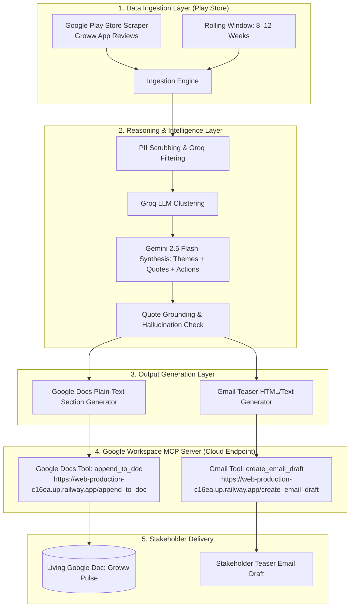

# Weekly Product Review Pulse — Problem Statement & Context

## 1. Executive Summary

The **Weekly Product Review Pulse** is an automated intelligence agent designed to ingest, analyze, synthesize, and deliver customer feedback from public mobile application store reviews. 

For the current implementation (**Phase 1**), the system is exclusively focused on **Groww** and ingests feedback strictly from the **Google Play Store**. 

Instead of manual spreadsheet analysis or ad-hoc API integrations, the agent interfaces with a **dedicated Google Workspace MCP (Model Context Protocol) Server (`https://web-production-c16ea.up.railway.app`)**. The agent processes reviews, extracts structured insights, and publishes outputs directly to **Google Docs** and **Gmail** through standard MCP tools (`append_to_doc`, `create_email_draft`, `send_email`).

### Scope & Target Product
- **Target Platform (Current Focus)**: **Groww** (Google Play Store — `com.nextbillion.groww`)
- **Review Source**: **Google Play Store only** (configurable 8–12 week rolling window)
- **MCP Infrastructure**: Cloud-hosted **Google Workspace MCP Server** (`https://web-production-c16ea.up.railway.app`) providing Google Docs and Gmail tools
- **Future Expansion Platforms**: *INDMoney, PowerUp Money, Wealth Monitor, Kuvera, and Apple App Store integration*

---

## 2. Core Objective

To provide Groww's **Product, Support, and Leadership** teams with a reliable, automated, and repeatable weekly pulse of public customer sentiment:
- Surface critical recurring themes from Google Play Store feedback.
- Extract validated, representative verbatim quotes.
- Formulate concrete, high-impact action recommendations.
- Eliminate manual copy-pasting, one-off spreadsheets, and fragmented review triage.

---

## 3. High-Level Architecture & Pipeline



---

## 4. Modular Separation of Concerns

| Concern | Implementation / Location | Description |
| :--- | :--- | :--- |
| **Data Retrieval** | Google Play Ingestion Module | Scrapes public reviews for Groww (`com.nextbillion.groww`) across a configurable rolling window (8–12 weeks). |
| **Reasoning & Analysis** | Clustering & LLM Pipeline | Performs PII scrubbing, LLM-based filtering and clustering (Groq), theme naming, verbatim quote extraction, and action idea generation (Gemini 2.5 Flash). |
| **Output Generation** | Report & Email Renderers | Formats structured text content for Google Docs append and crisp teaser text/HTML for stakeholder emails. |
| **Google Workspace MCP Server** | Cloud MCP Server (`https://web-production-c16ea.up.railway.app`) | Standalone MCP server exposing `append_to_doc`, `create_email_draft`, and `send_email` endpoints. Handles Google OAuth token flows isolated from the core agent. |
| **Agent / MCP Client** | MCP Host Agent (`src/agent/mcp_client.py`) | Orchestrates the entire pipeline, calling the MCP server tools for publishing without embedding direct Google REST API dependencies. |

---

## 5. Key System Requirements

### 1. Google Workspace MCP Server Integration
- The agent interfaces with the dedicated Google Workspace MCP server (`https://web-production-c16ea.up.railway.app`).
- Exposes tools for:
  - `append_to_doc`: Appending dated, structured text sections to a specified Google Doc.
  - `create_email_draft`: Creating draft teaser emails in Gmail with recipient, subject, and body.
  - `send_email`: Immediately sends teaser emails in Gmail without creating a draft.
- The agent runs as an MCP client and interacts with the server over standard HTTP/REST & MCP protocols with retry and authentication management.

### 2. Groww Google Play Store Specialization
- Optimized review ingestion targeted at Groww's Android app package.
- Intelligent pagination and date filtering to capture the rolling 8–12 week window.

### 3. Cadence & Backfill Capabilities
- **Scheduled Runs**: Executes on a weekly schedule (e.g., Monday morning IST) for Groww.
- **CLI Support**: Supports ad-hoc execution and backfill for any historical ISO week.

### 4. Idempotency & Run Safety
- Re-executing the agent for an existing `(Groww, ISO Week)` pair must **never** duplicate sections in the Google Doc or trigger duplicate emails.
- Enforced via deterministic section anchor headings in Docs and run-scoped idempotency checks for email delivery.

### 5. Auditability & Observability
- Every execution logs structured metadata: timestamp, product (`Groww`), target ISO week, review counts, generated Doc heading IDs, and Gmail message/draft IDs.

### 6. Safety, Privacy & Quality Control
- **PII Redaction**: Comprehensive scrubbing of personally identifiable information (names, emails, phone numbers, account IDs) prior to LLM processing and publishing.
- **Prompt Injection Defense**: Reviews are treated strictly as untrusted data inputs, never as executable instructions.
- **Quote Verification**: Strict substring/fuzzy matching to guarantee extracted quotes exist verbatim in source reviews.
- **Token & Cost Caps**: Enforced per-run token limits and cost constraints.

---

## 6. Target Audiences & Value Proposition

| Stakeholder Persona | Core Value Proposition for Groww |
| :--- | :--- |
| 🚀 **Product Management** | Prioritize Groww's roadmap and feature enhancements directly from clustered user friction points and feature requests (e.g., trading hour performance, portfolio insights). |
| 🛠️ **Customer Support & QA** | Rapidly detect recurring bug reports, payment/withdrawal friction, and crash regressions following app updates. |
| 📊 **Leadership & Executive** | Receive a high-level, executive health snapshot directly tied to authentic customer sentiment without wading through raw Play Store reviews. |

---

## 7. Delivery Specifications & Artifacts

1. **Canonical Google Doc (`Weekly Review Pulse — Groww`)**
   - Single running document acting as the permanent **system of record**.
   - Each weekly run appends a dated, week-labeled section with top themes, verbatim quotes, and action recommendations.

2. **Stakeholder Notification (Gmail)**
   - Short teaser email highlighting top themes.
   - Contains a direct anchor deep link (`#heading=...`) back to the specific week's section in the canonical Groww Google Doc.
   - **Environment Safety**: Defaults to creating drafts in `development`/`staging` environments, requiring explicit flags/confirmation for actual sending.

---

## 8. Illustrative Output Sample

```markdown
Groww — Weekly Review Pulse
Period: Last 8–12 weeks (rolling window) | Week: 2026-W32 | Source: Google Play Store

### Top Themes
1. App Performance & Bugs — Lag and crashes during market opening hours; session timeouts.
2. Customer Support Friction — Delayed ticket responses and unresolved queries.
3. UX & Feature Gaps — Confusing portfolio insight navigation; request for advanced analytics.

### Real User Quotes
> "The app freezes exactly when the market opens, very frustrating."
> "Support takes days to reply and doesn’t solve the issue."
> "Good for beginners but lacks detailed analysis tools."

### Action Ideas
- Stabilize peak-time performance: Scale infrastructure during market opening (9:15 AM IST) and improve crash telemetry.
- Improve support SLA transparency: Display estimated response times and live ticket status in-app.
- Enhance power-user features: Introduce advanced portfolio breakdown charts and streamline asset navigation.
```

---

## 9. Non-Goals (Explicitly Out of Scope for Phase 1)

- ❌ Multi-product ingestion in Phase 1 (INDMoney, PowerUp Money, Wealth Monitor, Kuvera are planned for future iterations).
- ❌ Apple App Store review ingestion in Phase 1 (Play Store only).
- ❌ External third-party hosted MCP infrastructure (the Google Workspace MCP server is built and hosted directly within this repository).
- ❌ Developing a generic Google Workspace integration suite beyond Docs append and Gmail send/draft tools.
- ❌ Real-time streaming dashboards or live BI analytics (the Google Doc serves as the living artifact).
- ❌ Ingesting social media feeds (e.g., Twitter/X, Reddit, LinkedIn).
- ❌ Embedding Google OAuth client secrets or user tokens directly into the agent logic.
